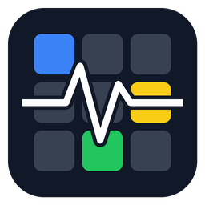
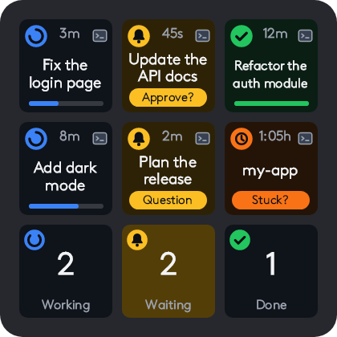
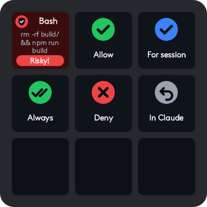

<p align="center">
  
</p>

<h1 align="center">SessionPulse</h1>

<p align="center">Live status of your Claude sessions on the Logitech MX Creative Keypad.</p>

<p align="center">
  
  &nbsp;&nbsp;
  
</p>

<p align="center"><em>Simulated pictures with made-up sessions, drawn with the plugin's real key renderer. Left: your sessions at a glance. Right: answering a permission request (optional).</em></p>

SessionPulse shows on the keypad's LCD keys which of your Claude Code sessions
are working, which are waiting for you and which are done: in the Claude
Desktop app, in a terminal on Windows and in WSL. Pressing a key opens exactly
that session.

**One keypad for all your Claude Code sessions, wherever they run.** Use them
side by side and see them together on the same keys:

* **Claude Code in Claude Desktop** (the Code tab)
* **Claude CLI on Windows**
* **Claude CLI in WSL**

You don't have to think about where a session lives: a key press takes you to
it, in Claude Desktop or in its terminal.

> **Status: early development.** All planned features are implemented. Testing
> on a real device has started but is not finished, so expect rough edges. See
> [the milestones](#roadmap) and the [device test plan](docs/device-test-plan.md).

SessionPulse is an independent, source-available project. It is not affiliated with
or endorsed by Anthropic or Logitech. "Claude" and "Logitech" are mentioned
only to describe what the software works with.

## How it works

Two independent parts that talk only through small local files:

1. A **Claude plugin** with a hook that writes one status file per session.
2. A **Logi Actions plugin** that watches these files and draws the keys.

Nothing leaves your computer: no network access, no conversation content. See
[docs/privacy.md](docs/privacy.md) for exactly what is written and read, and
[docs/architecture.md](docs/architecture.md) for the design.

## Requirements

* Windows 10/11, or macOS (new, device test pending: no dictation, no scrolling
  scheduled runs to the top; in Terminal and iTerm2 the key selects the tab)
* Claude Code in at least one of these: the Code tab of Claude Desktop, the
  `claude` command on Windows, or the `claude` command in WSL
* For Claude on Windows: Git for Windows (Claude runs hooks in Git Bash)
* Logi Options+ with Logi Plugin Service 6.4 or later, and an MX Creative Keypad

## Installation

Release packages are attached to each
[GitHub release](../../releases): `SessionPulse_X_Y_Z.lplug4` (keypad plugin)
and `sessionpulse-claude-plugin-X.Y.Z.zip` (Claude plugin).

### Claude plugin (hook)

Every Claude installation has its own settings: Claude on Windows (the Code
tab and the `claude` command share `%USERPROFILE%\.claude`) and Claude in WSL
(`~/.claude` inside Linux). Install the plugin in each one you use, through
one of the ways below. All of them write to the same folder on Windows,
`%USERPROFILE%\.sessionpulse`, where the keypad plugin looks.

The examples use `C:\Source\SessionPulse` for the folder of this repository
(or an unpacked release zip); use your own path.

**Claude Desktop, Code tab** (no `claude` command needed). Add this to
`%USERPROFILE%\.claude\settings.json` (create the file if it doesn't exist):

```json
{
  "extraKnownMarketplaces": {
    "sessionpulse": { "source": { "source": "directory", "path": "C:\\Source\\SessionPulse" } }
  },
  "enabledPlugins": { "sessionpulse@sessionpulse": true }
}
```

Then start a new session or run `/reload-plugins`. Such plugins are listed
under **+ → Plugins** next to the prompt box, not in Settings → Plugins. This
also covers the `claude` command on Windows.

**`claude` command on Windows** (PowerShell or cmd):

```bash
claude plugin marketplace add C:\Source\SessionPulse
```

```bash
claude plugin install sessionpulse@sessionpulse
```

**`claude` command in WSL.** Run this inside your WSL distribution; Windows
drives are under `/mnt`, so `C:\Source\SessionPulse` is
`/mnt/c/Source/SessionPulse`:

```bash
claude plugin marketplace add /mnt/c/Source/SessionPulse
```

```bash
claude plugin install sessionpulse@sessionpulse
```

On its first run in WSL, the hook asks Windows once for your user folder
(`cmd.exe /c echo %USERPROFILE%`), remembers the answer in
`~/.cache/sessionpulse/windows-dir` and from then on writes to
`/mnt/c/Users/<you>/.sessionpulse`. Your Linux and Windows user names may
differ; that's fine. If WSL can't start Windows programs (interop switched off
in `/etc/wsl.conf`), set the folder yourself in `~/.bashrc` or `~/.profile`:
`export SESSIONPULSE_DIR=/mnt/c/Users/<your Windows user>/.sessionpulse`.

**macOS** (Claude Desktop and the `claude` command share `~/.claude`). Use the
`settings.json` snippet above with your path (e.g. `/Users/<you>/SessionPulse`),
or run `claude plugin marketplace add ~/SessionPulse` and
`claude plugin install sessionpulse@sessionpulse`. The hook writes to
`~/Library/Application Support/SessionPulse` and works with the bash 3.2 that
macOS ships. The first key press on a Terminal or iTerm2 session asks for the
Automation permission (Logi Plugin Service controlling the terminal).

**Check:** send a prompt, then look for a new file in
`%USERPROFILE%\.sessionpulse\sessions\` (in Windows Explorer, not from inside
Claude: see [LESSONS](docs/LESSONS.md) #42).

**Cowork depends on your Claude Desktop version and account.** Hooks only run
where Cowork runs locally on your computer; such sessions appear on the keypad.
Elsewhere a Cowork task is a chat with a connected folder that runs in the
cloud; only its tool calls reach your computer, so no hook runs and the session
can't be shown ([LESSONS](docs/LESSONS.md) #46). Uploading the plugin zip in
Settings → Plugins does not change that, and it also loads the plugin into your
Code-tab sessions: install it through one route only, never both (#47).

### Keypad plugin

Double-click the `.lplug4` from the release and confirm the installer dialog
(it likes to hide behind other windows). Or build it yourself on Windows or macOS
(requires the .NET 10 SDK and Logi Options+ with Logi Plugin Service 6.4 or
later):

```bash
dotnet build src/SessionPulsePlugin -c Release -p:DevLink=false
```

```bash
dotnet tool restore
```

```bash
dotnet logiplugintool pack artifacts/plugin/Release/ artifacts/SessionPulse.lplug4
```

Then assign actions to keys in Options+ (group **SessionPulse**):

| Action | What it does |
|---|---|
| **Session 1** … **Session 8** | One session each, see below |
| **Working sessions**, **Waiting sessions**, **Done sessions** | Count on the key; opens a page with those sessions |
| **Scheduled tasks** | Count of unread runs; opens the newest run per scheduled task, unread first |
| **Next waiting session** | Opens the session that waits longest for you; shows how many wait |
| **Approvals** | Optional: answer Claude's permission requests on the keypad ([setup](docs/configuration.md#approvals-on-the-keypad-optional)) |
| **Dictation** | Optional, Windows: starts/stops dictation in a configured chat ([setup](docs/configuration.md#dictation-optional)) |

For development, `dotnet build src/SessionPulsePlugin` on Windows writes a
`.link` file so the service loads the plugin straight from `artifacts/`; remove
that file before installing a `.lplug4` (see [LESSONS](docs/LESSONS.md)). The
plugin is not part of the solution, so a `dotnet build` or `dotnet test` in the
repository root neither builds it nor writes that file.

## What the keys show

Each session key shows a round state badge at the top left, the main signal:

| Badge | Meaning |
|---|---|
| blue, spinning ring | working |
| yellow bell, key pulses | waiting for you; the reason is shown in a yellow pill at the bottom ("Approve?", "Question", …) |
| green check | done |
| orange clock | working, but no activity for a while: stuck? |
| gray pause | idle or stopped |
| violet arrows | compacting the conversation |
| red exclamation mark | stopped by an error or a usage limit |

Next to it the running time, at the top right the source (briefcase = Cowork,
terminal = Claude Code; a yellow dot instead marks an unread scheduled run), then
the session title and, if the session has a task list, a progress bar. The
title is the one Claude shows: from Claude Desktop, or for sessions in a
terminal the title Claude Code generated (or the one you set with `/rename`);
until there is one, the project folder.

Pressing a key opens that session; a finished session is acknowledged at the
same time and frees its key. Where it opens:

| Session | A key press |
|---|---|
| Claude Desktop | opens it in Claude Desktop |
| `claude` in a terminal on Windows | brings that terminal window to the front and, in Windows Terminal, selects the session's tab |
| `claude` in WSL | selects the session's tab in Windows Terminal and brings that window to the front |

The window is found exactly, also with several Windows Terminal windows. The
tab is found by its title: Claude Code shows the session title there (with a
status sign such as ✳ in front). That needs a title (from the end of the first
answer on) and a terminal where Claude Code sets it: in WSL it does; the
Windows `claude` in a cmd window left the tab at "Command Prompt" in our test,
so there only the window comes to the front. If two sessions have the same
title, the first tab wins. Other terminals (a
classic console window, VS Code) come to the front as a whole.

With an MX Master 4, SessionPulse also nudges you through haptic feedback
when a session waits for you, needs an approval or finishes
([haptics](docs/configuration.md#haptics-mx-master-4)).

Folder keys (**Working sessions**, **Waiting sessions**, **Done sessions**,
**Scheduled tasks**) show the same badge with a count and open a page with
the matching sessions; the done page ends with **Clear all**.

A session keeps its key while it is shown. When all keys are taken, a session
that needs you or is working replaces the oldest finished or idle one.

## Configuration

See [docs/configuration.md](docs/configuration.md). The most important switch:
`LABELS=0` in `%USERPROFILE%\.sessionpulse\sessionpulse.conf` stops the hook
from deriving key texts from your conversation (the start of a first Cowork
prompt, the generated title of a terminal session).

## Troubleshooting

* **No status files appear.** Check that Git for Windows is installed and that
  the plugin is enabled (`claude plugin list`). Plain chats send no hooks and
  never appear.
* **Nothing arrives from WSL.** The plugin must be installed inside WSL as
  well (`claude plugin list` there). `cat ~/.cache/sessionpulse/windows-dir`
  shows where the hook writes; delete that file to make it ask Windows again.
* **A terminal session's key shows the folder name.** Claude Code generates
  the title after the first answer; the key picks it up when that answer ends.
* **Pressing a terminal session's key does nothing, or only shows the window.**
  The terminal was closed; the session has no title yet (wait for the end of
  the first answer); or Claude Code doesn't set the terminal title
  (`CLAUDE_CODE_DISABLE_TERMINAL_TITLE` is set). The plugin log says why
  ("terminal tab not selected: …").
* **A key image never changes.** If you ever edited the key in the Options+
  icon editor, Options+ stores a frozen image that wins over the plugin. Use
  "reset to default" in the icon editor.
* **The plugin shows a warning in Options+** ("No session status yet"): the
  keypad plugin has not found any status file. Install the Claude plugin and
  send a prompt.
* **Plugin log:** `%LOCALAPPDATA%\Logi\LogiPluginService\Logs\plugin_logs\`.
  Set `VERBOSE=1` in `sessionpulse.conf` for more detail.
* More in [docs/LESSONS.md](docs/LESSONS.md).

## Uninstall

```bash
claude plugin uninstall sessionpulse@sessionpulse
```

Run this in each Claude installation you set up (Windows, WSL), or remove the
two entries from `settings.json`. Then delete `%USERPROFILE%\.sessionpulse`,
and in WSL `~/.cache/sessionpulse`.

## Development

```bash
bash tests/hook/run.sh
```

```bash
dotnet test
```

```bash
dotnet run --project tools/KeyPreview
```

`tools/KeyPreview` renders every key state to PNG files in
`artifacts/key-preview/` with the SDK's real drawing code, on any OS and
without a device. `dotnet run --project tools/KeyPreview -- --readme docs/images`
renders the keypad pictures at the top of this file.

The hook tests replay event sequences (`tests/hook/cases/`; built from the
documented payloads, `recorded-*` cases are anonymized real recordings) and
compare the resulting status files with golden files. The .NET tests include a contract
test that parses those golden files, so hook and plugin can't drift apart.

## Roadmap

| | Milestone | Status |
|---|---|---|
| M0 | Repository, docs, CI | done |
| M1 | Hook and status file with tests | done |
| M2 | Keypad plugin with session keys | done |
| M3 | Counter folders (working / waiting / done) | done |
| M4 | Scheduled tasks | done |
| M5 | Dictation (optional, Windows only) | built, device test pending |
| M7 | macOS | session keys tested on device (Terminal tab, Code tab) |
| M6 | Release pipeline | done ([docs/releasing.md](docs/releasing.md)) |

## License

[MIT with Commons Clause](LICENSE). Everyone may use, change and share
SessionPulse free of charge, privately and commercially, but may not sell it or
a product or service whose value comes substantially from it. Because of that
condition it is source-available, not open source.

The code uses the Logi Plugin API, which is
[Logitech's own licensed material](https://www.logitech.com/en-us/software/marketplace/developer-agreement.html)
and not covered by this license. It is not part of this repository or the
release packages.
